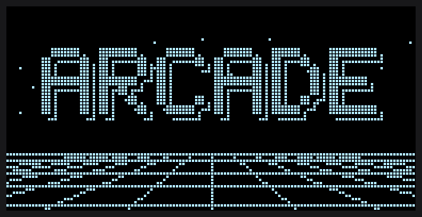
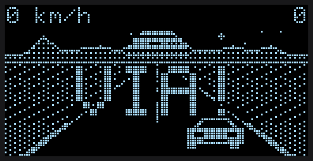
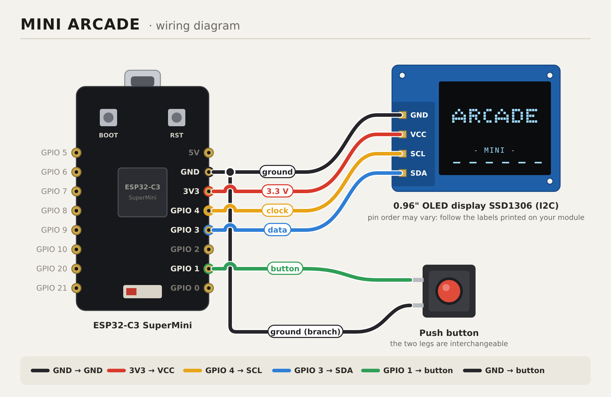

# Mini Arcade – one-button console with ESP32-C3 and OLED

A pocket console with **6 video games played with a single button**, on a 0.96" OLED display, powered by a tiny ESP32-C3 SuperMini board and programmed with the Arduino IDE.

## Features

- Animated start screen with the ARCADE logo
- Cover-style menu: each game has its own illustrated, animated cover with its title and your high score
- 6 one-button games with multi-layer scrolling backgrounds, particles and screen shake
- Difficulty grows with your score
- High scores are saved and survive power-off
- Just 6 wires and a button: beginner friendly

| Game | How to play |
| --- | --- |
| FLAPPY | Tap to flap your wings and fly between the pipes |
| TURBO | A perspective race at sunset: tap to switch lanes and dodge the cars |
| ROOFTOP | Run across the rooftops at night: tap to jump over crates and gaps |
| LANDER | Hold to fire the retro-rockets and land gently on the pad |
| DINO | Tap to jump over cacti while day and night take turns |
| STACK | Tap to drop the block and build the tallest tower |

## Materials

| Part | Qty | Notes |
| --- | --- | --- |
| ESP32-C3 SuperMini board | 1 | With USB-C port and BOOT and RST buttons |
| 0.96" OLED display SSD1306, 128x64, I2C | 1 | 4-pin version: GND, VCC, SCL, SDA |
| Tactile push button | 1 | 6x6 mm or 12x12 mm. Optional: the board's BOOT button works too |
| Female-to-female jumper wires or hookup wire | 6 | About 10 cm |
| USB-C data cable | 1 | To upload the program and power the console |

**Optional, to run on battery:** a 3.7 V single-cell LiPo with protection (500–1000 mAh), a TP4056 USB-C charging module **with protection** (B+, B-, OUT+, OUT- pads; DW01A + FS8205A chips) and a slide switch. Three alkaline AAA batteries in a holder with a switch (about 4.5 V) also work.

## Wiring

| From (ESP32-C3 SuperMini) | To | Function |
| --- | --- | --- |
| GND | Display GND | Ground |
| 3V3 | Display VCC | 3.3 V power |
| GPIO 4 | Display SCL | I2C clock |
| GPIO 3 | Display SDA | I2C data |
| GPIO 1 | Button leg 1 | Button signal |
| GND | Button leg 2 | Ground |

- **Power the display from the 3V3 pin**, not from 5V.
- **Check your display's pin order**: usually GND, VCC, SCL, SDA, but some modules swap GND and VCC.
- **The board has only one GND pin**: the display and button grounds share it (breadboard or solder both wires together).
- **The button has no polarity.** If it has 4 legs, use two on the same side.
- **Battery version:** TP4056 OUT+ → switch → board **5V** pin; OUT- → GND. Never connect a battery to 3V3, and switch it OFF when you plug the board into a computer.

## Installing the program

1. Install **Arduino IDE 2.x** from [arduino.cc/en/software](https://www.arduino.cc/en/software).
2. In **File > Preferences**, add this URL to "Additional boards manager URLs":
   `https://espressif.github.io/arduino-esp32/package_esp32_index.json`
3. In **Tools > Board > Boards Manager**, install **esp32** by Espressif Systems.
4. In **Sketch > Include Library > Manage Libraries**, install **Adafruit SSD1306** and **Adafruit GFX Library** (choose "Install all" for dependencies).
5. Download this repository (**Code > Download ZIP**), unzip it and open `mini_arcade/mini_arcade.ino`.
6. Connect the board and set in **Tools**:
   - Board: **ESP32C3 Dev Module**
   - USB CDC On Boot: **Enabled**
   - Port: the one that appeared when you plugged in the board
7. Press the **Upload** arrow (not Debug) and wait for "Done uploading".
8. Press **RST** on the board: the ARCADE screen appears.

If the port doesn't appear or the upload fails: unplug the cable, hold **BOOT**, plug it back in, release BOOT and upload again.

Using different pins? Change `PIN_SDA`, `PIN_SCL` and `BTN_PIN` at the top of the sketch.

## How to play

| Where you are | Short tap | Hold |
| --- | --- | --- |
| Start screen | Enter the menu | Enter the menu |
| Cover menu | Next game | Start the game (the "PLAY!" bar fills up) |
| During a game | Game action | 1.5 s: back to the menu (4 s in LANDER) |
| Game over | Play again | Back to the menu |

In LANDER the **F** bar shows fuel and the **V** bar your descent speed: stay below the mark to land. In STACK, three perfect drops in a row make the block a little wider.

## Troubleshooting

| Problem | Solution |
| --- | --- |
| The screen stays black | Check SDA and SCL. Open the Serial Monitor at 115200 baud: if it says "OLED display not found", change `OLED_ADDR` from `0x3C` to `0x3D` |
| The port doesn't appear | Use a USB-C **data** cable and try the BOOT button procedure |
| "OpenOCD: GDB Server Quit Unexpectedly" | You pressed Debug: use the Upload arrow |
| Empty Serial Monitor | Set USB CDC On Boot to Enabled and upload again |
| The button doesn't respond | One leg to GPIO 1, the other to GND. Try the BOOT button to rule out the push button |
| The board restarts on battery | The battery is flat or wired to the wrong pin: use 5V, never 3V3 |

## License

Code released under the [MIT License](LICENSE). Uses the Adafruit SSD1306 and Adafruit GFX libraries (BSD license). The games are inspired by genre classics, with original graphics and code.
